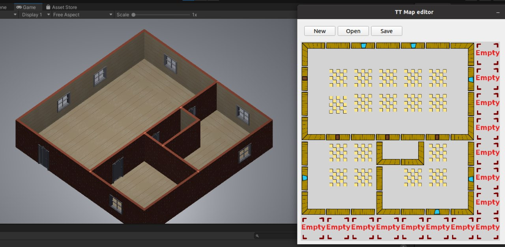

# TtMapEditor
Map editor for Unity 2.5D game

# Status
Only house editor is implemented.

Warning: Project is not finished. Interfaces and file format can be changed in the future.

# Map example


## Installation

To install and use **TtMapEditor**, follow these steps:

1. Clone the repository:

    ```bash
    git clone https://github.com/vitperov/TtMapEditor.git
    cd TtMapEditor
    ```

2. Install the required dependencies:

    ```bash
    pip install -r requirements.txt
    ```

## Where maps are stored

The editor opens and saves maps directly in the game project, so there is no
copying step. Set the two directories once under **Settings**:

| Setting | Points at | Used by |
| --- | --- | --- |
| Terrain Maps Directory | `<game>/Assets/Resources/Maps/Terrain` | Terrain editor |
| House Maps Directory | `<game>/Assets/Resources/Maps/House/json` | House editor |

They are independent because the two folders are unrelated in the game project;
neither is derived from the other. Both are stored in `settings/application.json`,
which is local to your machine and not committed.

Leave either one empty to fall back to the editor-local `output/terrain` and
`output/house` scratch folders, which is what you get without a game checkout.

**Open/Save** use these directories as their starting point. Once a map is open,
its path is shown in the title bar with a `*` when there are unsaved edits, and
**Save** (`Ctrl+S`) writes straight back to that file — use **Save As**
(`Ctrl+Shift+S`) to write somewhere else.


